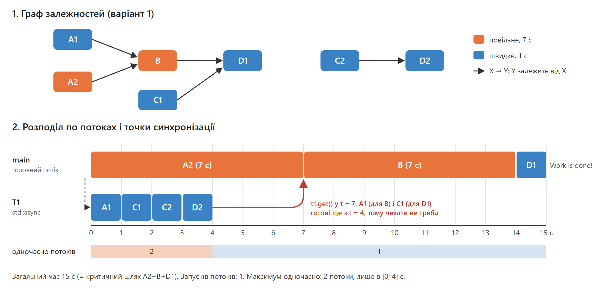

# Лабораторна 5, варіант 1

- Обчислення: A1, A2, B, C1, C2, D1, D2
- «Повільні» (7 с): A2, B. Решта «швидкі» (1 с)
- Залежності: B(A1, A2), D1(B, C1), D2(C2)

## Схема виконання



| потік | що виконує |
|---|---|
| main | A2 [0–7] → `t1.get()` → B [7–14] → D1 [14–15] |
| T1 (`std::async`) | A1 [0–1] → C1 [1–2] → C2 [2–3] → D2 [3–4] |

Точка синхронізації одна: `t1.get()` у main перед B. До цього моменту T1 уже виконав A1 (потрібне для B) і C1 (потрібне для D1). D2 залежить від C2, а обидва обчислення виконуються в T1 одне за одним.

## Чому ця схема оптимальна

1. **Час 15 с — мінімально можливий.** Критичний шлях A2→B→D1 триває 7+7+1 = 15 с.
2. **Менше двох потоків не вийде.** Уся робота триває 19 с, а це більше за 15 с. Двох потоків достатньо, і вони працюють одночасно лише 4 с (0–4).
3. **Запуск потоків — 1.** Це мінімум, бо одночасно має працювати 2 потоки.

Вивід синхронізовано через `std::osyncstream`. Для запуску потоку використано лише `std::async` з `<future>`. Спільних даних немає, тому data race неможливі. Є лише одне очікування, тож взаємоблокувань теж немає. Деструктор `std::future` дочекається завершення потоку навіть у разі винятку.

## Результат

```
A1
C1
C2
D2
A2
B
D1
Execution time: 15.027 s
Work is done!
```

## Запуск

- Командний рядок: `build.cmd`, потім `run.cmd`. Вихід зберігається в `results\output.txt`.
- Visual Studio: відкрити `Lab5.sln`, конфігурація Release.
- Звіт (малюнок схеми): `report/scheme.png` (вихідний файл — `report/scheme.svg`). Результат запуску: `results/screenshot.png`.
